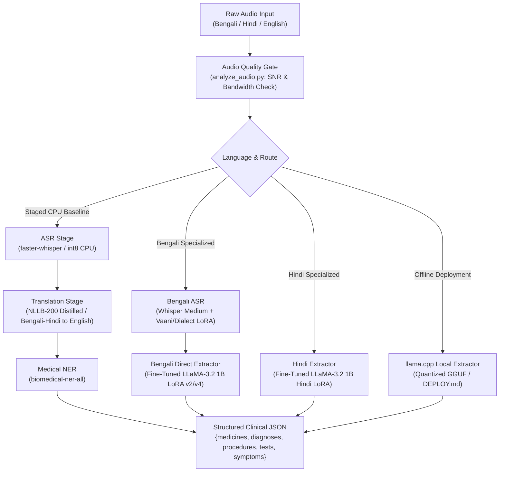

# Multilingual Speech Extraction

> **Automated Clinical Transcription & Medical Entity Extraction for Bengali, Hindi, and English Doctor–Patient Consultations**

An end-to-end system designed to transcribe noisy, low-resource doctor–patient phone calls and extract structured clinical entities (medicines, diagnoses, procedures, diagnostic tests, and symptoms) — optimized for **offline, on-premises CPU deployment** (e.g., 8 GB–16 GB RAM hospital workstations) without reliance on cloud APIs or external data transmission.

---

## Architecture Overview

The system supports multiple execution pathways depending on hardware constraints and deployment environments:



---

## Model Zoo & Included Weights

All custom-trained models and fine-tuned LoRA adapters are tracked directly in this repository using **Git LFS**:

| Model Artifact | Task / Domain | Base Architecture | Format / Size | Location |
|---|---|---|---|---|
| **`whisper-bn-vaani-max`** | Bengali Conversational ASR | Whisper Medium | LoRA Safetensors (~57 MB) | `Bengali/ASR/models/whisper-bn-vaani-max/` |
| **`whisper-bn-vaani-lora`** | Bengali Vaani Benchmark ASR | Whisper Medium | LoRA Safetensors (~38 MB) | `Bengali/ASR/models/whisper-bn-vaani-lora/` |
| **`whisper-bn-dialect-lora`**| Regional Bengali Dialect ASR | Whisper Medium | LoRA Safetensors (~38 MB) | `Bengali/ASR/models/whisper-bn-dialect-lora/` |
| **`bengali-lora-1b-v4`** | Bengali Medical Term Extractor (v4) | LLaMA-3.2 1B | LoRA Safetensors (~45 MB) | `Bengali/models/bengali-lora-1b-v4/` |
| **`bengali-lora-1b-v2`** | Bengali Medical Term Extractor (v2) | LLaMA-3.2 1B | LoRA Safetensors (~45 MB) | `Bengali/models/bengali-lora-1b-v2/` |
| **`hindi-lora-1b`** | Hindi Medical Term Extractor | LLaMA-3.2 1B | LoRA Safetensors (~23 MB) | `Hindi/models/hindi-lora-1b/` |
| **`medibeng`** | Bengali Token-Level Medical Extractor | Transformer Encoder | Full Model Safetensors (~151 MB)| `models/medibeng/` |

> [!NOTE]
> **Base models** (such as generic Whisper Medium, Meta NLLB-200, and base LLaMA-3.2) are intentionally excluded from the Git repository due to their size (~22 GB total). They can be downloaded automatically using the included resumable downloader: `python src/download_model.py <repo_id> <dest_dir>`.

---

## Repository Structure

```text
Voice-AI/
├── src/                               # Core pipeline scripts and utilities
│   ├── run_all.py                     # Master orchestrator: ASR -> Translate -> Extract
│   ├── transcribe.py                  # faster-whisper speech recognition runner
│   ├── translate.py                   # NLLB-200 neural machine translation runner
│   ├── extract.py                     # Biomedical NER token extraction
│   ├── extract_local.py               # Local GGUF/llama.cpp clinical extractor
│   ├── analyze_audio.py               # Spectrogram, frequency band, and SNR analysis
│   └── download_model.py              # Resumable, chunked model downloader from Hugging Face
│
├── Bengali/                           # Bengali ASR and NER development track
│   ├── ASR/                           # Whisper LoRA fine-tuning scripts, eval suite, WER/CER metrics
│   │   ├── models/                    # Trained Whisper LoRAs (vaani-lora, dialect-lora, vaani-max)
│   │   └── server/                    # Remote GPU training scripts, watchdog, and benchmark helpers
│   ├── models/                        # Fine-tuned Bengali LLaMA-3.2 LoRA extractors (v2 and v4)
│   ├── finetune_v2.py                 # PyTorch/PEFT training loop with negative-example conditioning
│   └── gen_data_bengali.py            # Synthetic clinical dialogue and surface variation generator
│
├── Hindi/                             # Hindi NLP and NER development track
│   ├── compare/                       # Cross-model evaluation benchmarks (Llama, Gemma, Qwen, Sarvam)
│   ├── models/hindi-lora-1b/          # Fine-tuned Hindi LLaMA-3.2 LoRA extractor
│   ├── finetune_local.py              # Local QLoRA fine-tuning script
│   └── gen_data_hindi.py              # Hindi medical conversation and entity generator
│
├── English ASR/                       # English baseline and fast CPU benchmarks
│   ├── benchmark_asr.py               # Benchmark runner (faster-whisper vs. Parakeet TDT)
│   ├── transcribe.py                  # English transcription runner
│   └── PLAN.md                        # Architecture roadmap for high-throughput clinical NER
│
├── models/                            # Base models directory and trained MediBeng artifacts
│   └── medibeng/                      # Fine-tuned token-level medical NER model
│
├── outputs/                           # Smoketest outputs and pipeline JSON validation results
├── outputs_audio/                     # End-to-end evaluation results on benchmark audio files (1–4)
│   └── SUMMARY_REPORT.html            # Visual plain-English summary report of clinical findings
│
├── DEPLOY.md                          # Production on-premises deployment guide (llama.cpp / CPU)
├── REPORT.md                          # In-depth technical engineering report, audio bottlenecks & RAM sizing
├── RUN_COMMANDS.md                    # Step-by-step training, evaluation, and server execution log
├── train_log.txt                      # Bengali ASR Whisper training log (initial run)
├── train_max_log.txt                  # Bengali ASR Whisper Vaani-Max training log
├── requirements.txt                   # Full baseline dependencies (PyTorch, Transformers, faster-whisper)
└── requirements_deploy.txt            # Lightweight runtime dependencies for offline deployment
```

---

## Sample Extraction Output

Given a transcribed doctor–patient consultation, the pipeline outputs clean, standardized JSON:

```json
{
  "file": "1.mp3.mpeg",
  "language": "Bengali",
  "duration_sec": 294.3,
  "medical_terms": {
    "medicines": [
      "Azithromycin",
      "Paracetamol",
      "Amlodipine",
      "Metformin"
    ],
    "diagnoses": [
      "Hypertension",
      "Type 2 Diabetes"
    ],
    "procedures": [
      "Follow-up consultation",
      "Blood pressure monitoring"
    ],
    "tests": [
      "Chest X-ray",
      "Fasting blood glucose"
    ],
    "symptoms": [
      "Fever",
      "Chest pain",
      "Dry cough"
    ]
  },
  "confidence_verified": true
}
```

---

## Quickstart & Installation

### 1. Environment Setup

Python 3.10 is recommended.

**Windows PowerShell:**
```powershell
py -3.10 -m venv .venv
.\.venv\Scripts\Activate.ps1
python -m pip install --upgrade pip
pip install -r requirements.txt
```

**Linux / macOS:**
```bash
python3.10 -m venv .venv
source .venv/bin/activate
pip install --upgrade pip
pip install -r requirements.txt
```

### 2. Downloading Base Models

To fetch the required base models from Hugging Face into the local `models/` folder:

```powershell
# faster-whisper (ASR)
python src/download_model.py Systran/faster-whisper-medium models/faster-whisper-medium

# NLLB-200 translation (Bengali/Hindi to English)
python src/download_model.py facebook/nllb-200-distilled-600M models/nllb-200-distilled-600M

# Biomedical NER
python src/download_model.py d4data/biomedical-ner-all models/biomedical-ner-all
```

*(For offline CPU deployment using `llama.cpp` and GGUF quants, see [DEPLOY.md](DEPLOY.md).)*

---

## Running the Pipeline

### Run the Full Staged Pipeline
Transcribe audio, translate non-English dialogue to English, and extract medical terms:

```powershell
python src/run_all.py "path/to/consultation.wav" --model small
```
*Outputs are saved under `outputs/`.*

### Run Stages Individually

```powershell
# Step 1: Speech-to-Text
python src/transcribe.py "path/to/consultation.wav" --model small --out outputs/transcript.json

# Step 2: Translation (Bengali/Hindi -> English)
python src/translate.py --in outputs/transcript.json --out outputs/translation.json

# Step 3: Medical Entity Extraction
python src/extract.py --in outputs/translation.json --out outputs/medical_terms.json
```

### Audio Quality Diagnostics
Before processing low-quality telephone recordings, inspect signal bandwidth and frequency distribution:

```powershell
python src/analyze_audio.py "path/to/audio.mp3"
```

---

## Key Engineering Insights

1. **The Telephony Audio Bottleneck**: Standard telephone audio (8 kHz, 16 kbps) lacks acoustic energy above 3 kHz. Generic multilingual Whisper hallucinates under these conditions because critical consonant frequencies are missing. As documented in [REPORT.md](REPORT.md), domain-adapted models (like `BanglaASR` and our fine-tuned Whisper LoRAs) recover genuine clinical phrasing where generic Whisper fails.
2. **Process-Isolated Memory Footprint**: To guarantee reliable operation on 8 GB RAM machines, `src/run_all.py` spawns each stage as a separate operating system process. This ensures RAM is completely freed between stages so the peak memory footprint never exceeds the single largest active model.
3. **Negative-Example Training Against Hallucination**: Follow-up, appointment, and fee-inquiry calls often led early LLM extractors to invent symptoms. Our v4 fine-tuning dataset incorporates explicit negative examples to enforce strict rejection of non-clinical conversations.

---

## Data Privacy & Security

- **Strict Exclusion of Patient Data**: All patient recordings, identifying call materials, raw audio clips (`.mp3`, `.mpeg`, `.wav`, `.pkl`), and training/validation datasets (`data/`, `Bengali/data/`, `Hindi/data/`, `Bengali/ASR/data/`) are excluded from Git tracking to protect confidentiality.
- **Air-Gapped Operation**: Once local weights are downloaded, the pipeline executes completely offline with zero network calls.
- **Credentials & Environment Files**: `.env` and virtual environments are permanently ignored by version control.

---

## Detailed Documentation Links

- **[REPORT.md](REPORT.md)**: Full engineering status report, audio spectrogram findings, RAM limits, and benchmark analysis.
- **[DEPLOY.md](DEPLOY.md)**: Guide for setting up offline on-prem deployments using `llama.cpp` and 4-bit quantized models.
- **[RUN_COMMANDS.md](RUN_COMMANDS.md)**: Step-by-step training logs and commands used during Bengali ASR LoRA fine-tuning.
- **[Hindi/README.md](Hindi/README.md)**: Architecture, synthetic data generation, and evaluation logs for Hindi extraction.
- **[English ASR/PLAN.md](English ASR/PLAN.md)**: High-speed English transcription benchmarks and OpenMed integration plans.

---

## License & Disclaimers

This repository is an experimental research and development toolkit. It is not an FDA/CE-cleared medical device. All extracted clinical terms must undergo human review by licensed medical professionals before any clinical or operational use. Individual model licenses (Meta LLaMA, OpenAI Whisper, NLLB) apply to their respective weights.
